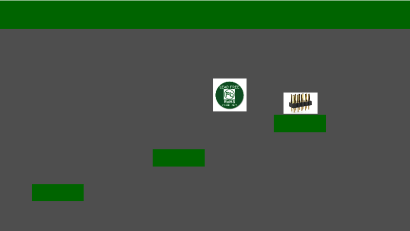
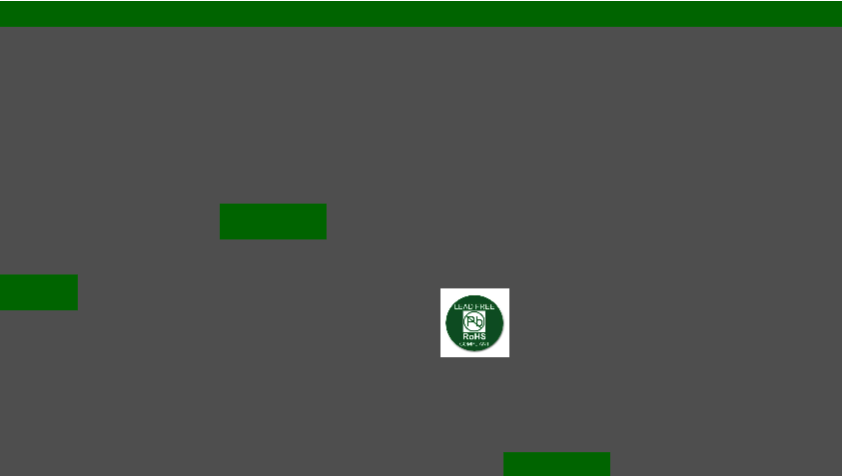

# Soldering Jumper
A game where you're some solder trying to find his friends to solder together!

This game was made for Jumpstart (Hack Club) so I could get funding for my Haven Event :p

Being made in GoDot, its code is really simple, just some get-touched-disappear code and gravity code. The map is sorta scuff but we don't talk about that...

No AI was used
